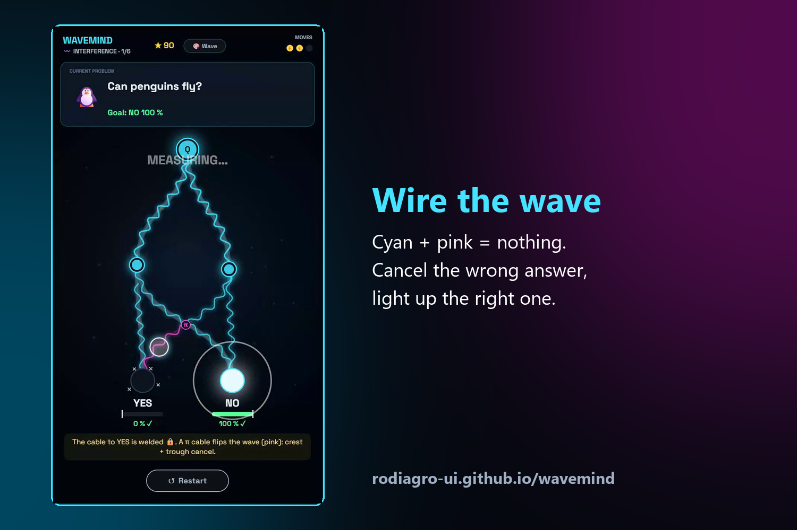

# WAVEMIND

**Quantum computers don't guess. They cancel the wrong answers. Can you?**

▶ **Play it now: https://rodiagro-ui.github.io/wavemind/**

🎬 **Video (1 min):** https://youtu.be/YtpUMioRC20

WAVEMIND is a quick, tap-to-play puzzle game about how quantum computers really "think". You rewire the cables of a quantum AI so that its wave cancels out on the false answers and builds up on the true one. It is built for the Cloud9 x JetBrains "Sky's the Limit" Hackathon 2026 (Category 3: Event Mini Game).



## How to play

- **Tap a cable** to connect or cut it. The wave flows from the **Q** core down to the answers.
- Cyan and pink are the same wave with opposite phase. Where a **crest meets a trough, they cancel**. A **π cable** flips the phase.
- 🔒 **Welded cables** can't be cut. You can only cancel them with interference.
- 🔥 **Hot neurons** scramble the wave (decoherence), so nothing interferes there.
- 👁 **Spy eyes** watch the path and break interference. Tap an eye to cover it.
- When the goal is met, the AI **measures**, and the answer lights up.
- 👁 **Colorblind mode** (title screen): π cables are drawn dashed and every lit cable shows a +/− sign, so phase never depends on colour alone.

## Modes

| Mode | For | What it is |
|---|---|---|
| **Arcade** | Event booth | A 75-second run with endless generated puzzles. Score comes from solving and from perfect (minimum-move) streaks. The run ends on a 3-letter arcade leaderboard with a **"Play at home" QR code** (generated in-game by a dependency-free QR encoder, so it works offline). Booth staff can export the day's scores as CSV and reset the board between event days. When nobody is playing, an **attract mode** plays itself. |
| **Story** | Players who want more | 5 chapters × 6 levels (Connections, Interference, Deep Networks, Noise, The Spy), unlocked with stars, plus a **final boss built on Grover's search algorithm**. Story levels have a **tap-to-preview, tap-to-confirm** control. |
| **Daily challenge** | Retention after the event | The same puzzle for everyone each day, with a Wordle-style shareable result. |
| **Quantum Album** | Story rewards | Every story level unlocks half of an animated collectible card about real quantum phenomena: the double slit, solar fusion tunnelling, entanglement, lasers, superconductors, GPS atomic clocks and more. |

## The physics (simplified, but honest)

- **Superposition:** a neuron splits its amplitude evenly over its active cables (a/√k), so total probability is conserved.
- **Phase:** a π cable multiplies the amplitude by −1.
- **Interference:** amplitudes add at every neuron, so +½ and −½ give 0.
- **Measurement:** P(answer) = |amplitude|² (Born rule), normalized over the outputs.
- **Decoherence:** hot neurons and open spy eyes tag the paths that pass through them. Paths with different tags add *probabilities*, not amplitudes, so they no longer interfere.

What we simplify: phases are only 0 or π, and merging cables is not strictly unitary, so we normalize at measurement. The in-game "The science" screen explains this.

Every generated level is checked by a brute-force solver. It guarantees the level can be solved, computes the minimum number of moves (used for stars and scoring), and makes interference or noise matter where the chapter requires it.

## Tests

```bash
npm test
```

The headless suite runs the real game script with a stubbed canvas. It checks exact destructive interference, Born-rule normalization, decoherence, the observer effect, Grover's 100% result, the solvability and determinism of all 30 story levels, the 75-second arcade run and translation coverage.

## Booth-ready: soak test

`tools/booth_soak_test.py` (Playwright) plays **30 Arcade sessions back to back in one page**, as on an event day. Each simulated player starts from the title, solves 4–8 puzzles, enters initials and leaves. Results on a laptop:

- clean reset for every player: timer 75 s, score 0, streak 0;
- 58–61 fps throughout;
- JS heap stays between 2 and 8 MB, with no growth trend;
- leaderboard capped at 10;
- 0 page errors.

## Run it

It is a single HTML file with no build step and no dependencies. Open `index.html` in any modern browser, or serve the folder:

```bash
npx serve .
```

## Running it at a booth

WAVEMIND supports a **booth display mode** for a second monitor that shows a live leaderboard — no Wi-Fi needed. Both windows share the same `localStorage` on the same machine, so the display updates automatically when a player finishes a run.

1. **Player screen:** Open `index.html` normally (or `index.html#arcade` to start the arcade mode directly).
2. **Second monitor (staff display):** Open `index.html#display` in a new browser window and move it to the second monitor. It shows a full-screen leaderboard with the top 10 scores, a "Play at home" QR code, and the game URL. New entries are highlighted with a glow animation.
3. The display updates live — no reload needed. It listens for changes and polls every 2 seconds as a fallback.

Everything works fully offline — the QR code is generated in-browser with no external dependencies.

## Tools

- **JetBrains WebStorm** with **JetBrains Air**, driving the **Junie** coding agent (it built the colorblind mode). The two-agent workflow story is in [`AI_SHOWCASE.md`](AI_SHOWCASE.md).
- Claude Code (Anthropic) for design iteration, physics prototyping and testing
- Plain HTML5 Canvas + JavaScript, Web Audio API, Google Font *Space Grotesk*

## License

MIT. See [LICENSE](LICENSE).
